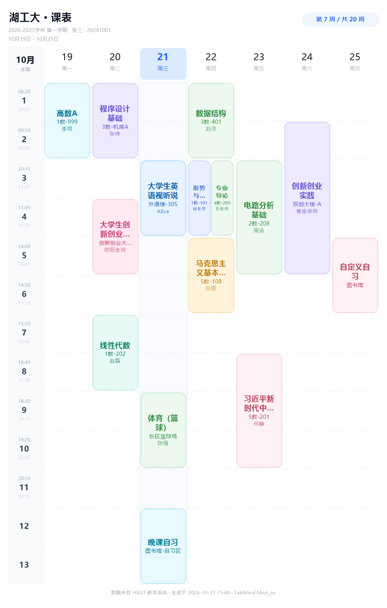

# hbut-jw-bot-plugin

湖北工业大学（HBUT）教务课表插件 —— 为 [TabMind](https://github.com/tabew/TabMind) 框架提供。

学生在 QQ 里发 `/课表`，机器人就回一张**本周课表图片**；发 `/课表 5` 就是第 5 周。
登录支持 **学习通扫码** 与 **统一身份认证账号密码** 两种方式。

> 接口与登录流程参考了 [superdaobo/mini-hbut](https://github.com/superdaobo/mini-hbut) 与
> [meixu0/hbut-api-collection](https://github.com/meixu0/hbut-api-collection)，仅做协议对接，不包含任何绕过授权的逻辑。

---

## 功能

| 指令 | 说明 |
|---|---|
| `/课表` | 本周课表图片 |
| `/课表 5` | 第 5 周（也认 `/课表第5周`、`/kb 5`） |
| `/课表 @某人` | 看被 @ 的人的课表（对方需自己登录过） |
| `/课表 3 @某人` | 看对方第 3 周 |
| `/课表 隐私 开/关` | 别人能不能 @ 你查你的课表（默认允许） |
| `/课表 扫码` | 学习通 App 扫码登录（**仅私聊**） |
| `/课表 登录 学号 密码` | 统一身份认证登录（**仅私聊**，通常需要验证码） |
| `/课表 验证码 1234` | 补填登录验证码 |
| `/课表 课程` | 列出课程编号，改课程前先看编号 |
| `/课表 改 1 教室=1教-301 教师=李明` | 改课程信息（见下） |
| `/课表 加 名称=自习 星期=3 节次=4 连堂=1 周数=1-16` | 加一节自定义课（节次=第几个大节） |
| `/课表 删 1` | 隐藏某门课（教务刷新后依然隐藏） |
| `/课表 还原` | 清除所有本地改动 |
| `/课表 时间` | 查看每节上课时间 |
| `/课表 时间 3 10:15-11:00` | 改第 3 节时间 |
| `/课表 状态` | 查看当前会话是否有效 |
| `/课表 诊断` | 逐项体检：会话 / xhid / 校历 / 课表接口 |
| `/课表 学期 2026-2027-1` | 切换学期 |
| `/课表 退出` | 清除本地会话 |
| `/课表 帮助` | 指令列表 |



出图排版（对齐 HBUT 手机端 / [mini-hbut](https://github.com/superdaobo/mini-hbut) 的课表）：

- **按大节排布**：每 2 小节合并成 1 个大节，共 6 行（1: 8:20-9:55、2: 10:15-11:50、3: 14:00-15:35、
  4: 15:55-17:30、5: 18:30-20:05、6: 20:10-20:55），与小节编排的教务数据自动换算
- **顶部绿头**：学期、学号、本周日期范围、周次胶囊；日期行显示「日号 + 星期」，当天白色圆圈高亮
- **左侧时间轴**：大节号 / 上课时间 / 下课时间
- **课程卡**：饱和色圆角块 + 白色居中文字，课名最多 3 行，教室与教师按剩余高度依次显示，
  **内容一律裁剪在卡片内**，不会溢出
- 同一格里真有冲突的多门课才分栏；教务把连堂课拆成多条记录时自动合并，不会劈成两半
- 画布 1000px 宽、按手机查看比例设字号，缩放到手机宽度后文字仍清晰

## 看别人的课表

群里 **@机器人 + `/课表 @同学`** 就会把对方的课表发出来：

```
@机器人 /课表 @张三          # 张三本周课表
@机器人 /课表 5 @张三        # 张三第 5 周
```

规则：

- 对方得**自己登录过**（每人的 Cookie 各自存在 `data/hbut_jw/users/<QQ>.json`），没登录会提示让对方先扫码；
- 用的是**对方自己的**改名/隐藏设置，不是你的；
- 默认允许被查看，本人发 `/课表 隐私 关` 可禁止（再发 `/课表 隐私 开` 恢复）；
- 群聊若开了「必须 @ 机器人」门禁，记得 @ 一下机器人；或把 `hbut_jw` 加进 `config.json` 的
  `onebot.at_exempt_plugins`，这样群里直接发 `/课表 @同学` 也能触发。

## 改课程信息

先发 `/课表 课程` 拿到编号，然后：

```
/课表 改 2 名称=高数A 教室=1教-999 教师=李明 星期=3 节次=3 周数=1-16
/课表 删 3              # 隐藏第 3 门课
/课表 加 名称=自习 星期=7 节次=5 连堂=1 周数=1-20 教室=图书馆
/课表 还原              # 全部恢复成教务原始数据
```

> `节次` 指**第几个大节**（1~6，一大节 = 两小节）；`连堂` 表示占几个大节，默认 1。

可用字段：`名称 / 教室 / 教师 / 星期 / 节次 / 连堂 / 周数 / 隐藏`，中英文都认（`name`、`room`、`teacher`、`weekday`、`period`、`count`、`weeks`）。
也可以直接写课名代替编号，例如 `/课表 改 体育（篮球） 教室=东区球场`。

改动只存在本地，不动教务数据，随时 `/课表 还原` 撤销。

## 安装

1. 下载 [dist/hbut_jw.dll](dist/hbut_jw.dll)（或自行编译）。
2. 放进 TabMind 运行目录的 `plugins\`（源码树里是 `plugins\`，发行包是 `bin\Release\plugins\`）。
3. 重启 TabMind，在「插件管理」里确认出现 **湖工大教务**。

运行时数据都在 `data\hbut_jw\`：

```
data\hbut_jw\
├── users\<QQ号>.json    登录态（Cookie + 学号 + xhid + 学期）
├── custom\<QQ号>.json   课程改动（改名 / 隐藏 / 自定义课程）
├── privacy.json         设置了「不许别人查看课表」的 QQ
├── times.json           作息时间（改过 /课表 时间 才会生成）
├── out\                 生成的课表图片
└── tmp\                 扫码二维码 / 登录验证码（用完即弃）
```

## 登录方式

### 1）学习通扫码（推荐）

`/课表 扫码` → 机器人发来一张二维码 → 用「学习通」App 扫一扫并在手机上确认 →
机器人回「✅ 学习通登录成功」→ 之后 `/课表` 即可。

技术路径：`passport2.chaoxing.com` 申请 `uuid/enc` → `createqr` 取图 →
轮询 `getauthstatus/v2` 拿到 `.chaoxing.com` 域票据 → 访问 `i.chaoxing.com/base`
取页面里的 `xxtlogin` 补票链路并逐个请求 → 服务端给 `hbut.jw.chaoxing.com`
下发 `jw_uf` 短票 → 进入学习通教务。

### 2）账号密码

`/课表 登录 20241001 你的密码` →
若学校要求验证码，机器人会把验证码图片发给你，回 `/课表 验证码 图中的字符` 即完成。

技术路径：`auth.hbut.edu.cn/authserver/login` 取 `execution` / `lt` / `pwdEncryptSalt` →
AES-128-CBC 加密密码（明文 = 64 位随机串 + 密码，与官网前端一致）→
POST 表单 → 302 带 ticket 回 `jwxt.hbut.edu.cn` 建立会话。

> 密码只在本次登录的内存里用一次，**不写盘、不记录**。保存的只有 Cookie 会话。

## 用到的接口

| 用途 | 接口 |
|---|---|
| 学习通二维码 | `GET /login?fid=&refer=http://i.chaoxing.com`（取 uuid/enc）<br>`GET /createqr?uuid=&fid=-1`（二维码图）<br>`POST /getauthstatus/v2`（轮询状态） |
| 统一身份认证 | `GET /authserver/login?service=`（取隐藏字段）<br>`GET /authserver/getCaptcha.htl`（验证码）<br>`POST /authserver/login?service=`（提交） |
| 学号内部 ID | `GET {教务}/admin/xsd/pkgl/xskb/queryKbForXsd?xnxq=` |
| 课表 | `GET {教务}/admin/xsd/pkgl/xskb/sdpkkbList?xnxq=&xhid=&xqdm=1&zdzc=&zxzc=&xskbxslx=0` |
| 校历（周次日期） | `GET {教务}/admin/xsd/jcsj/xlgl/getData/{xnxq}` |

`{教务}` 会自动选：学习通登录 → `https://hbut.jw.chaoxing.com`；账号密码登录 → `https://jwxt.hbut.edu.cn`。

## 编译

要求 Visual Studio 2022（v143）+ Windows SDK 10，**无第三方依赖**（HTTP 用 WinHTTP，画图用 GDI+，AES 自带实现）。

### 方式一：脚本

```bat
:: 放进 TabMind 源码树的 plugins\hbut_jw\ 后直接双击
build_plugin.bat
```

脚本里的 MSVC / SDK 路径是本机的，换机器改前几行即可。

### 方式二：Visual Studio

把本目录整个放到 TabMind 的 `plugins\hbut_jw\`，用 `hbut_jw.vcxproj` 生成；
若放在别处，需要指定头文件目录：

```bat
msbuild hbut_jw.vcxproj /p:Configuration=Release /p:Platform=x64 /p:TabMindInclude=D:\path\to\TabMind\include
```

插件依赖 TabMind 的 `include\plugin_manager.hpp`（`IBotPlugin` / `PluginContext`），
运行库必须与宿主一致（**Release 用 `/MT`**），否则跨 DLL 传 `std::string` 会崩。

## 自测工具（`tests/`）

| 程序 | 作用 |
|---|---|
| `preview.cpp` | 假数据渲染课表（含超长课名、同格重叠、12/13 节、本地改写等极端用例），输出 `tests/preview.png` 与放大检查图 `tests/crop.png` |
| `net_probe.cpp` | 真实请求：申请学习通二维码 / 抓 CAS 登录页与验证码，验证接口是否可达 |
| `plugin_smoke.cpp` | `LoadLibrary` 加载 DLL，模拟消息，验证导出与指令路由 |

均为本地调试用，不参与插件构建。

## 已知限制

- 校历接口偶尔 404，此时周次按「学期起始周」估算，图片底部会标注。
- 学习通扫码要求 App 端确认；二维码约 2 分钟有效，超时重发即可。
- 群聊禁止登录指令（会泄露学号密码 / 二维码可被他人扫走），扫码与登录请私聊。
- 学期切换后需重新 `/课表` 拉取；`xhid` 与学期绑定，切学期会自动重取。
- 改了课程信息后若要按新「星期/大节」出现在对应格子，需同时给 `星期=` / `节次=`，只改名字或教室不会挪位置。
- 接口里 `djs` 是**大节号**（`ceil(djc/2)`），不是连堂小节数；老接口若给的是连堂数，插件会按 `djs == ceil(djc/2)` 自动识别两种语义。

## License

GPL-3.0，见 [LICENSE](LICENSE)。
